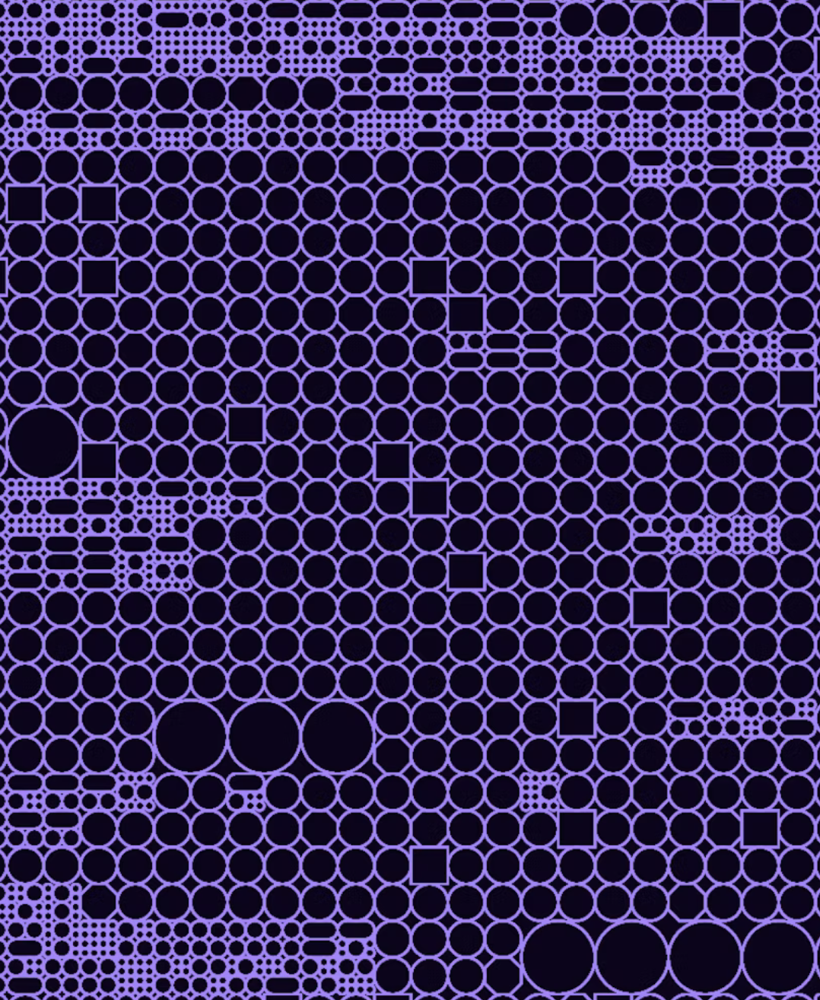

# Jacobo

A generative sketch library written in [jank](https://book.jank-lang.org/),
a Clojure dialect with native C++ interop, and rendered with
[raylib](https://www.raylib.com/).

The first milestone is a working native build and a simple sketch: lavender
circles, squares, and small clusters on a near-black canvas. The reference
sets the direction for richer packing, capsules, and variation in scale.



## Setup

On Apple Silicon macOS with Homebrew:

```sh
brew install jank-lang/jank/jank just raylib
brew install borkdude/brew/clj-kondo
just doctor
just lint
just build
just smoke
just run
```

`just build` produces `target/jacobo`; run it directly to open the sketch.
Press Escape or close the window to exit. `just smoke` builds and checks native
linking without opening a window. `just clean` removes build outputs.

The scaffold uses the jank CLI directly, with no JVM or Leiningen dependency.
For another raylib installation, set `RAYLIB_PREFIX` to a prefix containing
`include/raylib.h` and `lib/`. Other platforms are not yet verified.

## Layout

- `src/jacobo/sketch.jank` — reusable rendering functions.
- `src/jacobo/main.jank` — window lifecycle and entry point.
- `scripts/jank.sh` — native include/library discovery and compiler invocation.
- `AGENTS.md` — mission and contributor workflow.

## Linting

`just lint` explicitly discovers `.jank` files under `src/` and includes
`hallo.jank`, checking them together as Clojure. Directory scans in clj-kondo
currently skip this extension. The setup was verified with clj-kondo 2026.10.26.

`.clj-kondo/config.edn` exempts the native `cpp` namespace from unresolved
namespace warnings. A small hook removes only `:include` clauses from the
linter's view of `ns`; ordinary namespace checks remain enabled. This does
not modify the source or affect compilation.

C++ names, native signatures, and jank-specific type conversions still need
`just build` and runtime verification. Additional jank special forms may need
more hooks as the project grows. Editors must recognize `.jank` as Clojure
and invoke clj-kondo in Clojure mode to use this configuration.

## Live sketch REPL

Run `just repl` to open the sketch and start a local nREPL server. Connect
your editor's nREPL client to `127.0.0.1` using the printed port or the
project's `.nrepl-port` file. Use `just repl 5555` to request a specific port.
This command runs the window and server; it does not show a terminal REPL prompt.

Open `src/jacobo/sketch.jank`, change the colors or geometry in `draw!`, then
evaluate that function in the `jacobo.sketch` namespace. The next frames use
the new definition. Evaluating the whole buffer through nREPL also works.
For example, evaluate this in that namespace to temporarily clear the canvas:

```clojure
(defn draw! []
  (cpp/ClearBackground (cpp/Color 20 10 40 255))
  nil)
```

Re-evaluate the original `draw!` from the file to restore the pattern. Saving
alone does not reload code. Window dimensions are read when the window opens,
so changes to `width` and `height` require restarting `just repl`.

Raylib drawing and window calls stay on the main thread. Define functions
through nREPL, but do not call `draw!`, `run-sketch!`, or raylib graphics
functions directly from the editor's evaluation thread. Ordinary drawing
exceptions are caught so you can fix and re-evaluate a broken function;
`@jacobo.dev/last-error` reports the failure state (native crashes cannot be
recovered this way).

Press Escape, close the window, or evaluate `(jacobo.dev/stop!)` to end the
sketch. Start one REPL per project directory so `.nrepl-port` identifies the
right process. The development server uses jank's bundled nREPL API, verified
with the installed jank 0.1 alpha, and may need updates with future releases.

jank is alpha software; compiler compatibility should be checked against the
installed `jank --help`. See the [jank book](https://book.jank-lang.org/) for
language and C++ interop guidance.
